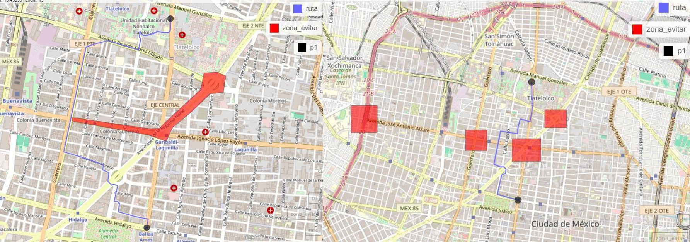
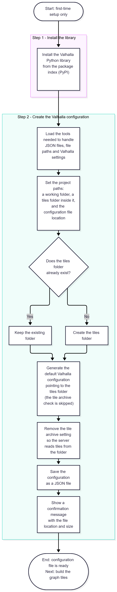
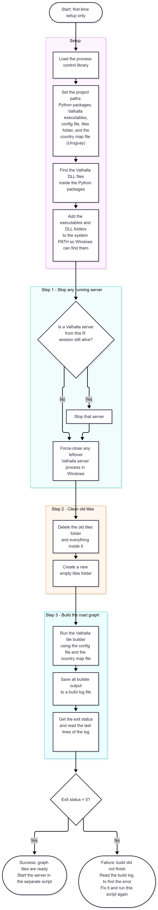
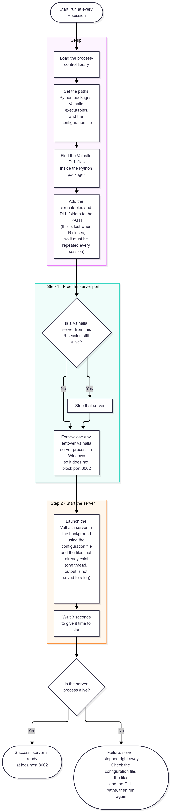
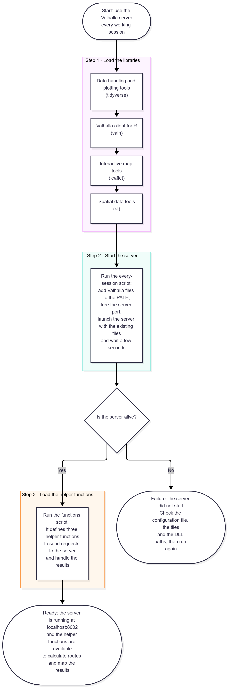

## The project

This project is inspired by the [osrm.backend](https://github.com/e-kotov/osrm.backend) R package, developed by [Egor Kotov](https://www.ekotov.pro/), which installs and runs a local OSRM server directly from R.

The goal is to do the same with https://github.com/valhalla/valhalla: an alternative routing engine to OSRM that is also local, open source and runs **without Docker**. The Valhalla binaries (`valhalla_build_tiles` and `valhalla_service`) come from the https://pypi.org/project/pyvalhalla/ package, and the whole workflow is driven from R: building the tiles from an `.osm.pbf` file, starting the server and sending queries.

### Why Valhalla?

Compared to OSRM, Valhalla offers two key advantages:

- **Multimodal routing:** routes can be computed by car, on foot, by bicycle and by public transit.
- **Areas to avoid:** you can define one or more polygons the route must not cross, for example for safety reasons, road closures, natural hazards or events. Valhalla excludes them **at query time**, without rebuilding the graph. This is not possible in OSRM, because the network is fixed once it has been preprocessed.

## Workflow

The process for use it is this, using positron canbe easy clone this work because you need a venv 
This are the steps.

* 1. First-time setup: create the configuration
  * Run: 01_py_1.py then 01_r_1.R .. if we get "0" on status all is ok :D 
* 2. First-time setup: build the graph tiles
* 3. Every R session: start the server
* 4. Usage
  * Run with source: 03_call.R

### Example avoid route

### 1. First-time setup: create the configuration

### 2. First-time setup: build the graph tiles

### 3. Every R session: start the server

### 4. Usage

