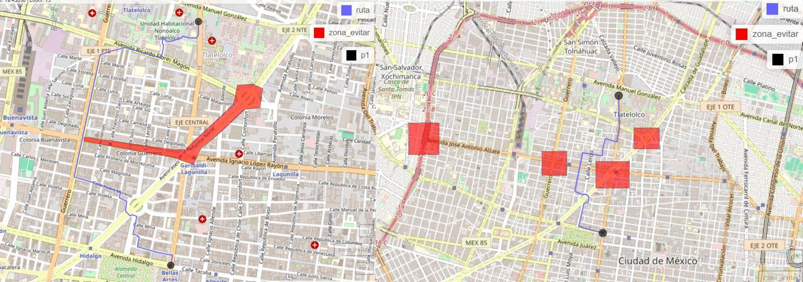
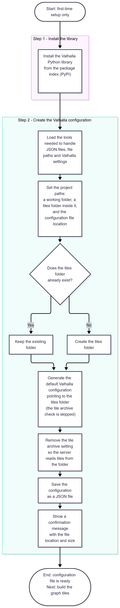
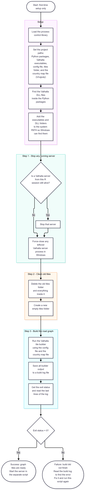
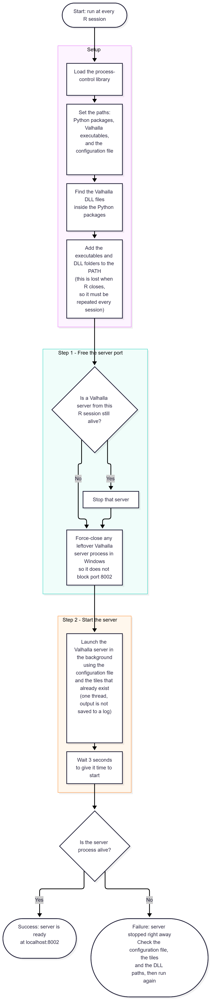
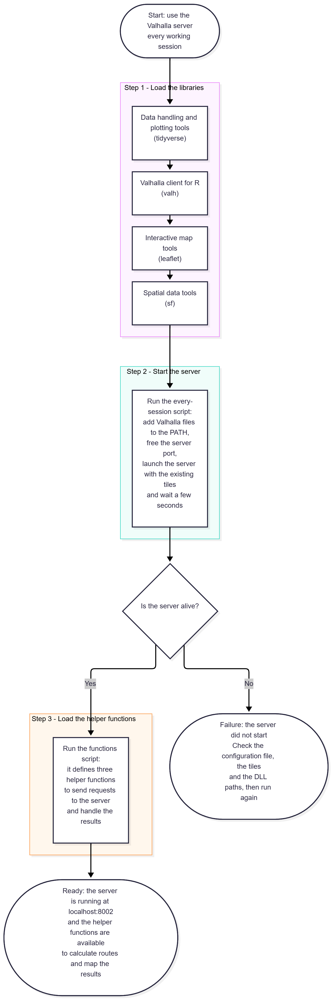

## Workflow

The process for use it is this, using positron canbe easy clone this work because you need a venv 
This are the steps.

* 1. First-time setup: create the configuration
  * Run: 01_py_1.py then 01_r_1.R .. if we get "0" on status all is ok :D 
* 2. First-time setup: build the graph tiles
* 3. Every R session: start the server
* 4. Usage
  * Run with source: 03_call.R

### Example avoid route

### 1. First-time setup: create the configuration

### 2. First-time setup: build the graph tiles

### 3. Every R session: start the server

### 4. Usage

